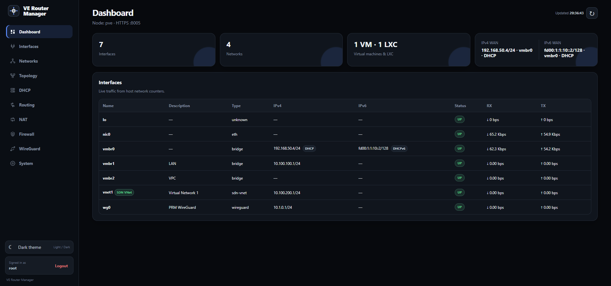
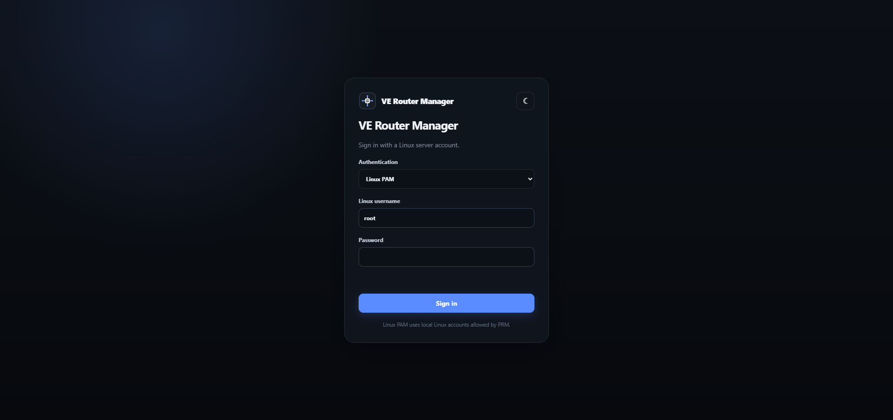
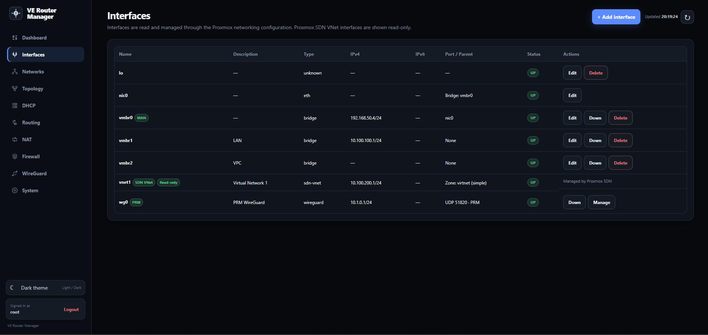
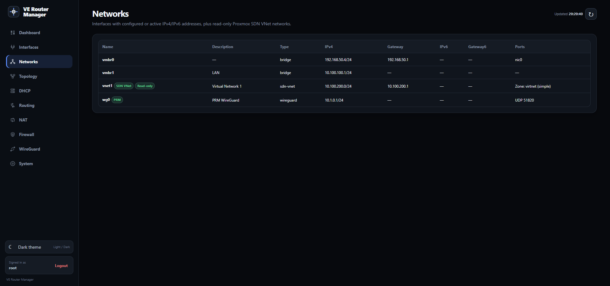
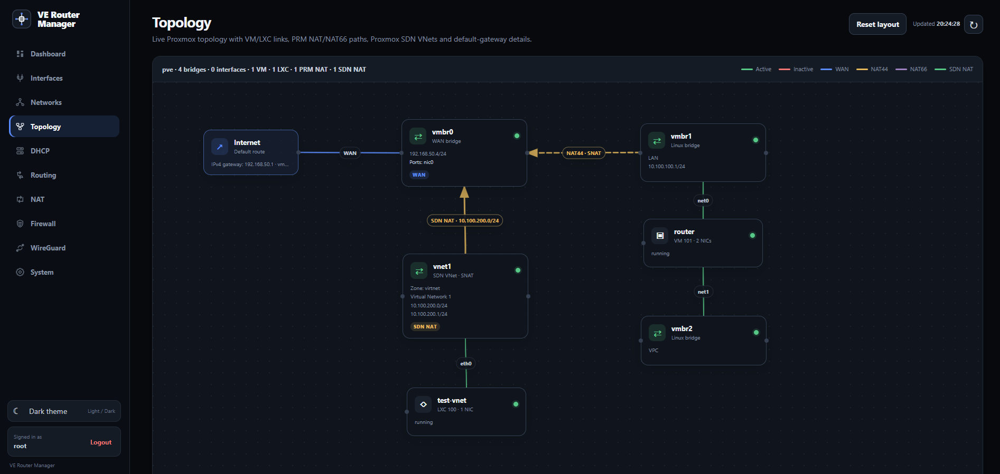
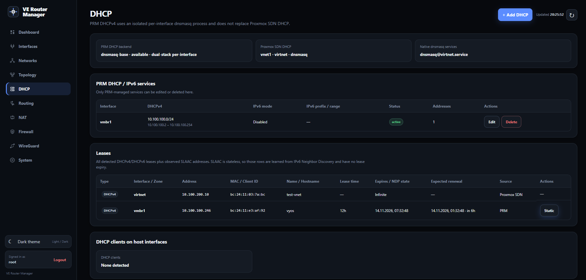
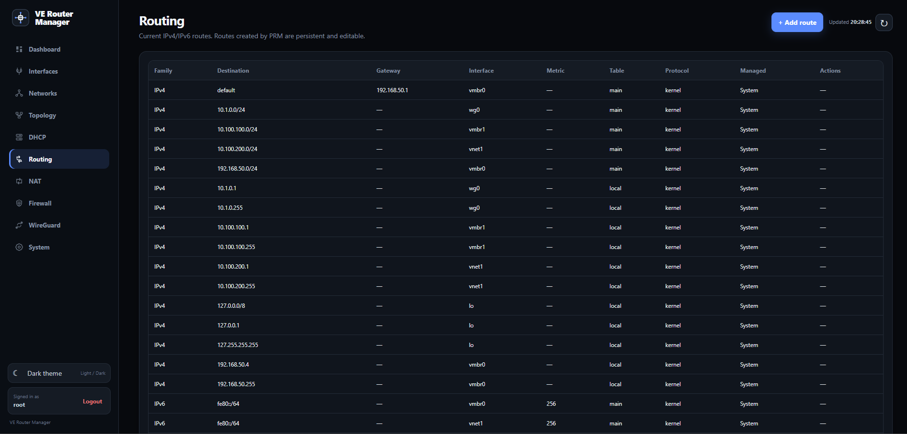
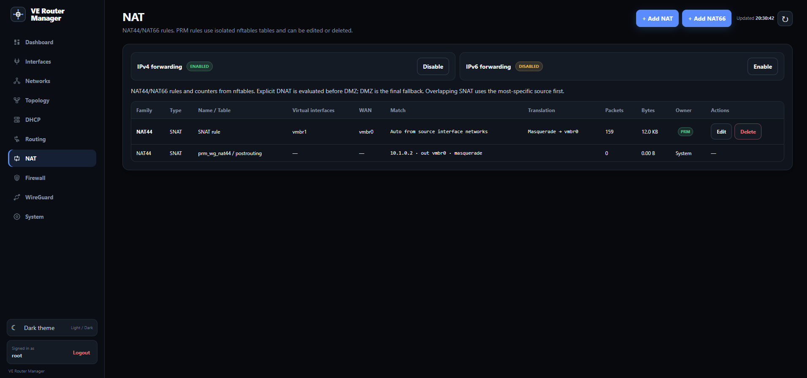
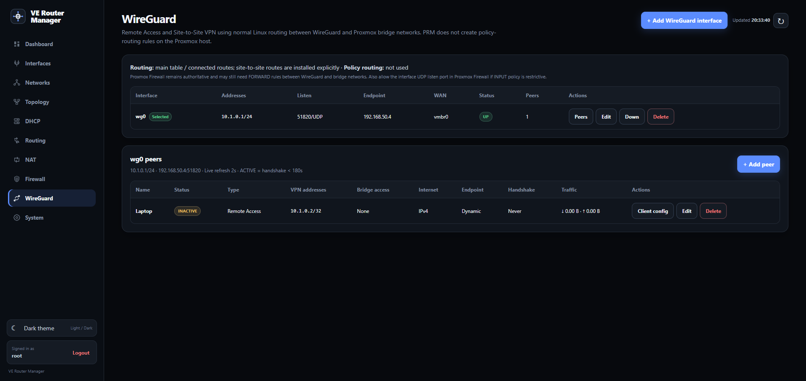
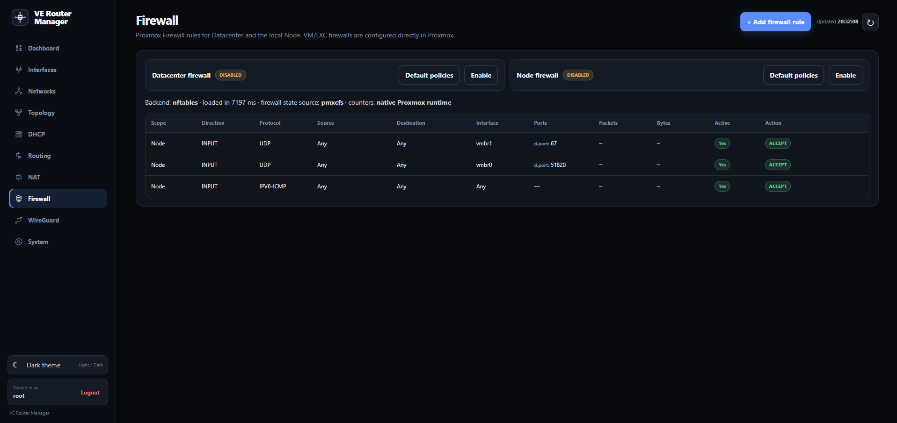

<h1 align="center">
  
  VE Router Manager
</h1>

<p align="center">
  
  
  
  
</p>

**VE Router Manager (PRM)** is a lightweight host-native network and router management interface for **Proxmox VE**.

PRM runs directly on the Proxmox host and provides a dedicated HTTPS web interface for interfaces, networks, routing, NAT, DHCP, IPv4/IPv6, WireGuard, Proxmox Firewall, read-only Proxmox SDN VNet visibility and live network topology — without requiring a separate router VM.

[Quick Start](https://github.com/RyVolodya/ve-router-manager#-quick-start) · [Features](https://github.com/RyVolodya/ve-router-manager#-what-can-prm-do) · [Topology](https://github.com/RyVolodya/ve-router-manager#topology) · [Screenshots](https://github.com/RyVolodya/ve-router-manager#-screenshots) · [Installation](https://github.com/RyVolodya/ve-router-manager#installation) · [Security](https://github.com/RyVolodya/ve-router-manager#-security-considerations) · [Roadmap](https://github.com/RyVolodya/ve-router-manager#-roadmap)



> Dashboard example — interface status, WAN addresses, virtual machine information and Proxmox cluster status in one place.

---

## Overview

PRM turns a Proxmox VE node into a manageable software router while keeping the native Proxmox VE interface available.

```text
Proxmox VE
├── Proxmox Web UI :8006
└── PRM Web UI     :8005
```

PRM focuses on the network layer:

- Interfaces
- Networks
- Routing
- DHCP
- NAT44 / NAT66
- WireGuard
- IPv4 / IPv6
- Datacenter Firewall
- Node Firewall
- Read-only Proxmox SDN VNet visibility
- Live network topology

Virtual machine and LXC lifecycle management remains in the native Proxmox VE interface.

---

## 🚀 What can PRM do

### Dashboard

The Dashboard provides an overview of the current Proxmox node:

- Node name
- PRM HTTPS port
- VM and LXC information
- Network interfaces
- Proxmox SDN VNet interfaces in read-only mode
- WAN IPv4
- WAN IPv6
- Interface status
- Live RX / TX information
- Live RX / TX counters for deployed SDN VNet interfaces
- Proxmox cluster information when available

Standalone node example:

```text
Node: prox-lab · HTTPS :8005
```

Cluster node example:

```text
Node: prox-lab · HTTPS :8005
Cluster: Main-cluster (192.168.50.10)
```

The cluster address shown is the Corosync address of the current node.

---

## Interfaces

PRM can manage Proxmox networking directly on the host and displays both active and pending Proxmox network configuration.

Supported interface types include:

- Linux Bridge
- Bond
- VLAN
- Physical interfaces
- Virtual interfaces
- Proxmox SDN VNet interfaces — **read-only**

Available operations for PRM-managed interfaces:

- Create
- Edit
- Delete
- Bring virtual interfaces Up
- Bring virtual interfaces Down
- IPv4 configuration
- IPv6 configuration
- Interface status
- RX / TX statistics
- Apply or revert pending Proxmox network changes

Interface changes are staged through Proxmox networking and applied with rollback protection. After a network change is applied, PRM requires confirmation before the rollback timer expires, helping protect remote management access.

Proxmox SDN VNet interfaces are monitoring-only in PRM. They do not expose **Edit**, **Down** or **Delete** controls, and Proxmox SDN remains the source of truth.

PRM uses the native Proxmox network configuration and is designed to coexist with the Proxmox VE web interface.

---

## Networks

The **Networks** page provides a routed-network view of the local Proxmox node.

It displays:

- Interface / network name
- Description
- Interface type
- IPv4 address or subnet
- IPv4 gateway
- IPv6 address or subnet
- IPv6 gateway
- Bridge ports
- Proxmox SDN VNet zone metadata
- SDN VNet IPv4 / IPv6 subnets and runtime addresses

Proxmox SDN VNet networks are displayed **read-only**. PRM does not modify SDN VNet, Zone or Subnet configuration.

---

## IPv4 and IPv6

PRM supports dual-stack networking.

### IPv4

Supported configuration includes:

- Static IPv4
- DHCPv4 client mode using native Proxmox / ifupdown2 networking
- Gateway
- Routing
- NAT44
- DNAT
- SNAT
- DMZ
- Persistent IPv4 mode restoration after reboot

### IPv6

Supported configuration includes:

- Static IPv6
- SLAAC / Router Advertisement
- DHCPv6
- Combined DHCPv6 + SLAAC
- Optional IPv6 default route learned from Router Advertisement
- IPv6 routing
- NAT66
- WireGuard IPv6
- IPv6 forwarding
- Persistent IPv6 mode restoration after reboot

When **Static IPv6** is selected for an interface, PRM disables SLAAC/autoconfiguration on that interface so an additional dynamic IPv6 address is not created beside the configured static address.

Example:

```text
Static IPv6:
fd00:1:1:10::1111/64
```

---

## Routing

PRM provides IPv4 and IPv6 routing management directly on the Proxmox host.

Supported operations include:

- View existing IPv4 and IPv6 routes
- Add persistent static routes
- Edit PRM-managed routes
- Delete PRM-managed routes
- IPv4 default routes
- IPv6 default routes
- Routes through WireGuard interfaces
- IPv4 forwarding
- IPv6 forwarding

Routes created by PRM are restored automatically after reboot.

Example:

```text
10.100.100.0/24      dev vmbr1
fd10:10:100:100::/64 dev vmbr1
fd00:1::/64          dev wg1
```

---

## DHCP

PRM includes integrated DHCP services for Proxmox networks.

PRM DHCPv4 uses an isolated per-interface `dnsmasq` process. Native Proxmox SDN DHCP is detected and PRM does not create a duplicate DHCP / RA service on the same VNet.

### DHCPv4

Features include:

- IPv4 pools
- Default gateway
- DNS servers
- Lease time
- Static reservations
- Editable reservation address and name
- Duplicate-address validation against reservations, active leases and local addresses
- L2 address probing before a reservation is created
- Lease monitoring

### DHCPv6

Features include:

- DHCPv6 pools
- IPv6 DNS servers
- Static reservations using DHCPv6 DUID / client ID
- Editable reservation addresses
- DHCPv6 leases
- Automatic Node Firewall permit for active DHCPv6 services

### SLAAC

Router Advertisement can be enabled for IPv6 networks.

DHCPv6 and SLAAC can also be used together. In **DHCPv6 + SLAAC** mode, clients may receive both a stateful DHCPv6 address and an autonomous SLAAC address from the same `/64`; the IPv6 default gateway is advertised through RA.

The lease view also includes observed SLAAC addresses learned through IPv6 Neighbor Discovery. Because SLAAC is stateless, those entries do not have a DHCP lease expiry.

Example network:

```text
PRM vmbr1:
10.100.100.1/24
fd10:10:100:100::1/64
```

Example client:

```text
10.100.100.2
fd10:10:100:100::2
```

PRM automatically creates the required Node Firewall rules for active DHCP services.

---

## NAT

PRM supports both IPv4 and IPv6 NAT using isolated PRM-owned `nftables` tables.

NAT rules are persistent and recreated deterministically after reboot. PRM also handles the Proxmox `fwbr` conntrack-zone requirements needed for NAT to work correctly with Proxmox VM firewall bridges.

### NAT44

Supported types:

- SNAT
- MASQUERADE
- DNAT
- DMZ
- Source-interface selection
- WireGuard interfaces as NAT sources
- Rule packet / byte counters

### NAT66

Supported IPv6 NAT functionality includes:

- IPv6 source NAT
- IPv6 masquerade
- IPv6 destination NAT
- NAT66 DMZ / exposed-host mode when explicitly required
- WireGuard IPv6 / NAT66 Internet access
- Rule packet / byte counters

---

## DNAT and DMZ priority

Explicit DNAT rules have priority over DMZ.

Processing order:

```text
1. Specific DNAT rules
2. DMZ exclusions
3. DMZ
```

Example:

```text
TCP 443  → 10.100.100.20:443
TCP 8080 → 10.100.100.30:80
DMZ      → 10.100.100.100
```

Result:

```text
TCP 443        → 10.100.100.20
TCP 8080       → 10.100.100.30
Other traffic  → 10.100.100.100
```

DMZ therefore acts as the final fallback.

PRM automatically excludes its required management and service ports from DMZ when necessary. Configured or running WireGuard UDP listener ports are also excluded automatically.

---

## SNAT priority

When SNAT rules overlap, more specific networks are processed first.

Example:

```text
10.100.100.50/32 → specific SNAT
10.100.100.0/24  → MASQUERADE
```

The `/32` rule is evaluated before the `/24` rule.

The same principle applies to IPv6:

```text
/128 before /64
```

---

## WireGuard

PRM includes integrated WireGuard management.

Features include:

- Multiple WireGuard interfaces
- Remote Access peers
- Site-to-Site peers
- IPv4 addresses
- IPv6 addresses
- Optional automatically allocated ULA IPv6 addressing
- Peer management
- Client configuration generation
- QR code generation
- Per-peer access to selected Proxmox bridge networks
- Internet-only peers
- IPv4 Internet access through VPN
- IPv6 Internet access through VPN using NAT66
- Ordinary main-table routes for Site-to-Site remote networks
- Persistent keepalive
- Live peer status and traffic counters
- Automatic Proxmox Node Firewall permit for WireGuard UDP listeners

WireGuard interfaces are also visible where relevant in **Interfaces**, **Dashboard**, **Networks**, **Routing** and **NAT**.

PRM uses normal Linux routing between WireGuard and Proxmox bridge networks and does not create policy-routing rules for WireGuard peers.

Live information includes:

- ACTIVE / INACTIVE status
- Latest handshake
- Remote endpoint
- RX
- TX

Example:

```text
wg1:
10.9.0.1/24
fd00:1::1/64

Peer:
10.9.0.2/32
fd00:1::2/128
```

WireGuard peers can access internal networks through normal routing.

Example:

```text
WireGuard:
fd00:1::2

Internal network:
fd10:10:100:100::/64

Pi-hole:
fd10:10:100:100::2
```

No NAT66 is required between these networks when normal IPv6 routing is used.

---

## Firewall

PRM deliberately manages only two Proxmox firewall scopes:

```text
Datacenter Firewall
Node Firewall
```

VM and LXC firewall configuration is intentionally left to the native Proxmox VE interface.

This keeps PRM focused on networking and avoids duplicating guest-level management already provided by Proxmox.

### Datacenter Firewall

Datacenter Firewall configuration is cluster-wide.

Typical uses:

- Common management access rules
- Cluster-wide security policy
- INPUT rules
- OUTPUT rules
- FORWARD rules
- Default policies

Example:

```text
IN ACCEPT
Source: 192.168.50.0/24
Protocol: TCP
Destination Port: 8006
```

### Node Firewall

Node Firewall rules apply to the Proxmox node where PRM is running.

PRM automatically maintains required Node Firewall rules for services such as:

- PRM HTTPS :8005
- DHCPv4
- DHCPv6
- WireGuard UDP listeners
- Required IPv6 / ICMPv6 traffic

PRM-generated automatic rules are protected from accidental modification or deletion.

Firewall management also includes:

- Datacenter and Node default-policy dialogs
- API-first synchronization with the current Proxmox Firewall state
- Immediate backend reload after supported firewall changes
- A lockout guard for potentially dangerous firewall changes

---

## Firewall default policies

PRM exposes the Proxmox default firewall policies:

```text
INPUT
OUTPUT
FORWARD
```

Typical router-oriented configuration:

```text
INPUT:   DROP
OUTPUT:  ACCEPT
FORWARD: ACCEPT
```

Actual policies should be selected according to the required security model.

---

## Proxmox clusters

PRM can run on a Proxmox node that belongs to a cluster.

PRM continues to manage networking locally on the node where it is installed:

```text
Interfaces
Routing
NAT
DHCP
WireGuard
Node Firewall
```

Datacenter Firewall configuration remains cluster-wide through the native Proxmox cluster filesystem.

Proxmox SDN configuration is also cluster-level. PRM discovers SDN VNets, Zones and Subnets and displays the relevant local-node runtime state **read-only**.

This means that if Datacenter Firewall or SDN configuration is changed through Proxmox, PRM will display the updated configuration.

PRM does not attempt to manage networking on other cluster nodes remotely.

---

## Topology

The **Topology** page provides a live, draggable view of the local Proxmox networking layout.

It can display:

- Local VM and LXC network attachments
- Linux bridges
- Physical and virtual interfaces
- VLAN labels
- WAN links
- Running / stopped link state
- PRM NAT44 paths
- PRM NAT66 paths
- Proxmox SDN VNets and their subnets
- Proxmox SDN NAT / NAT66 paths
- Internet / Default Router
- IPv4 and IPv6 default gateway IP addresses
- Outgoing interface used by each default route

Topology is a visualization and monitoring view. Proxmox SDN objects shown there remain read-only.

---

## Architecture

Example topology:

```text
                    Internet
                       │
                       │
                    vmbr0
                       │
              ┌────────┴────────┐
              │   Proxmox VE    │
              │       +         │
              │      PRM        │
              └────────┬────────┘
                       │
             ┌─────────┼─────────┐
             │         │         │
           vmbr1      wg1      other
             │         │
      10.100.100.0/24  │
 fd10:10:100:100::/64  │
             │         │
          VM/LXC    VPN peers
```

PRM runs directly on the Proxmox host.

No additional router VM is required.

---

## ⚡ Quick Start

Download the latest `.deb` package from GitHub Releases.

Install PRM:

```bash
apt install ./prm_0.4.50_all.deb
```

Open PRM:

```text
https://PROXMOX-IP:8005
```

The native Proxmox VE interface remains available at:

```text
https://PROXMOX-IP:8006
```

Upgrade an existing installation:

```bash
apt install ./prm_0.4.50_all.deb
```

Check installed version:

```bash
dpkg-query -W prm
```

---

## Installation

Download the latest `.deb` package from GitHub Releases and install it with:

```bash
apt install ./prm_0.4.50_all.deb
```

For upgrades, install the newer `.deb` package with the same command.

If a corrected package is rebuilt with the same version number, force a reinstall with:

```bash
apt install --reinstall ./prm_0.4.50_all.deb
```

### Uninstallation

Remove PRM while keeping package configuration files:

```bash
apt remove prm
```

Remove PRM package configuration as well:

```bash
apt purge prm
```

PRM removal stops PRM-owned services and removes PRM-owned runtime NAT / WireGuard helper rules. It does not stop or modify the native Proxmox `pveproxy` service or the Proxmox web interface on TCP `8006`.

---

## Access

PRM:

```text
https://PROXMOX-IP:8005
```

Native Proxmox VE:

```text
https://PROXMOX-IP:8006
```

Both interfaces can operate simultaneously.

---

## Authentication

PRM supports two authentication modes:

### Linux PAM

- Uses local Linux accounts on the Proxmox node
- Authentication is performed through PAM
- No separate PRM user database is required

### Proxmox VE

- Uses Proxmox VE users in `user@realm` format
- Users must have the `Sys.Modify` privilege on `/`
- Proxmox VE TOTP two-factor authentication is supported
- The TOTP field is shown after the password is successfully verified when 2FA is required

Authenticated PRM sessions use secure `HttpOnly`, `Secure`, `SameSite=Strict` cookies.

---

## Services

Depending on enabled features, PRM manages services and configuration related to:

```text
Networking
DHCP
NAT
WireGuard
Firewall
Routing
```

PRM networking changes are designed to remain persistent after reboot.

---

## 🔐 Security Considerations

PRM runs directly on the Proxmox host and can modify host-level networking, routing, NAT, DHCP, WireGuard and firewall configuration.

### Built-in web security hardening

PRM v0.4.50 includes:

- Login rate limiting / brute-force protection
- Rate limiting keyed by client IP, username and authentication mode
- Progressive blocking: 5 failed attempts → 30 seconds, 10 → 5 minutes, 20 → 30 minutes within the rate-limit window
- HTTP `429 Too Many Requests` with `Retry-After`
- Per-session CSRF tokens for write requests
- Same-origin `Origin` / `Referer` validation
- `HttpOnly`, `Secure`, `SameSite=Strict` session cookies
- HSTS
- Content Security Policy (CSP)
- `X-Frame-Options: DENY`
- `X-Content-Type-Options: nosniff`
- `Referrer-Policy`
- `Permissions-Policy`
- Cross-Origin Opener / Resource Policy headers
- Static-file path traversal protection

Recommended practices:

- Restrict access to PRM TCP port `8005` to trusted management networks.
- Keep the Proxmox host and PRM package updated.
- Use strong PAM credentials.
- Do not expose the PRM web interface directly to the public Internet unless it is protected by an appropriate firewall or VPN.
- Review Datacenter and Node Firewall rules carefully before applying restrictive policies.
- Keep access to the native Proxmox VE interface on port `8006` while testing network or firewall changes.
- Back up `/etc/network/interfaces` and relevant `/etc/pve/` firewall configuration before major changes.
- Never publish WireGuard private keys, passwords, tokens or other sensitive configuration in screenshots or issue reports.

Because PRM operates at the host networking layer, an incorrect route, NAT or firewall rule can cause loss of remote access to the Proxmox node.

---

## Upgrade safety

PRM is designed to preserve existing configuration during package upgrades.

Network interface changes use a safe apply workflow with a host-side rollback transaction. If the new configuration is not confirmed before the rollback timeout, PRM can restore the previous network state. The active rollback transaction survives a browser refresh or reconnect.

Before applying pending Proxmox network configuration, PRM also checks that the current default-route interface is not accidentally removed.

Before major network changes, it is still recommended to keep a backup of:

```text
/etc/network/interfaces
/etc/pve/firewall/
/etc/pve/nodes/
```

Network changes should always be tested carefully on remote Proxmox systems to avoid losing management connectivity.

---

## Package

Current release:

```text
PRM v0.4.50
```

Package:

```text
prm_0.4.50_all.deb
```

SHA256:

```text
b8f177b41d471296fd9097453eacdb78cda8ffc2ec86fb173bc3ddc00c85941e
```

---

## Project scope

PRM is not intended to replace the Proxmox VE management interface.

Its purpose is to provide dedicated network and router management for the Proxmox host.

### Managed by PRM

```text
Interfaces
IPv4 / IPv6
Routing
DHCPv4 / DHCPv6
SLAAC
NAT44 / NAT66
SNAT / DNAT / DMZ
WireGuard
Datacenter Firewall
Node Firewall
```

### Read-only visibility in PRM

```text
Proxmox SDN VNet interfaces
SDN Zones / Subnets
VM / LXC network attachments in Topology
Default gateway details
Local-node SDN runtime state
```

### Managed by Proxmox VE

```text
Virtual machines
LXC containers
Guest firewall
Storage
Backups
Replication
HA
Cluster administration
```

---

## 📸 Screenshots

### Login / Authentication



### Dashboard


### Interfaces



### Networks



### Topology



### DHCP



### Routing



### NAT



### WireGuard



### Firewall



Additional screenshots can be added as the project evolves.

---

## 🛣 Roadmap

Potential future improvements:

- Additional routing features
- VRF support
- Extended VLAN management
- Improved IPv6 diagnostics
- Network configuration backup / restore
- Firewall counters and logging
- Extended dashboard monitoring
- Additional VPN capabilities
- Improved cluster awareness

---

## Contributing

Bug reports, feature requests and pull requests are welcome.

When reporting networking issues, please include relevant diagnostic information such as:

```text
PRM version
Proxmox VE version
Interface configuration
Routing table
Relevant nftables / firewall rules
```

Remove passwords, private keys, public addresses and other sensitive information before publishing logs.

---

## Disclaimer

PRM modifies host-level networking, routing, NAT and firewall configuration.

Incorrect network or firewall configuration can cause loss of access to the Proxmox node.

Always verify network changes carefully, especially on remotely managed servers.

---

## License

This project is licensed under the GPLv3 License.
See the [LICENSE](LICENSE) file for details.

Copyright © 2026 Volodymyr Rybak.

---

<div align="center">

**VE Router Manager**

*Routing · NAT · DHCP · IPv4/IPv6 · WireGuard · Firewall for Proxmox VE*

**v0.4.50**

</div>
